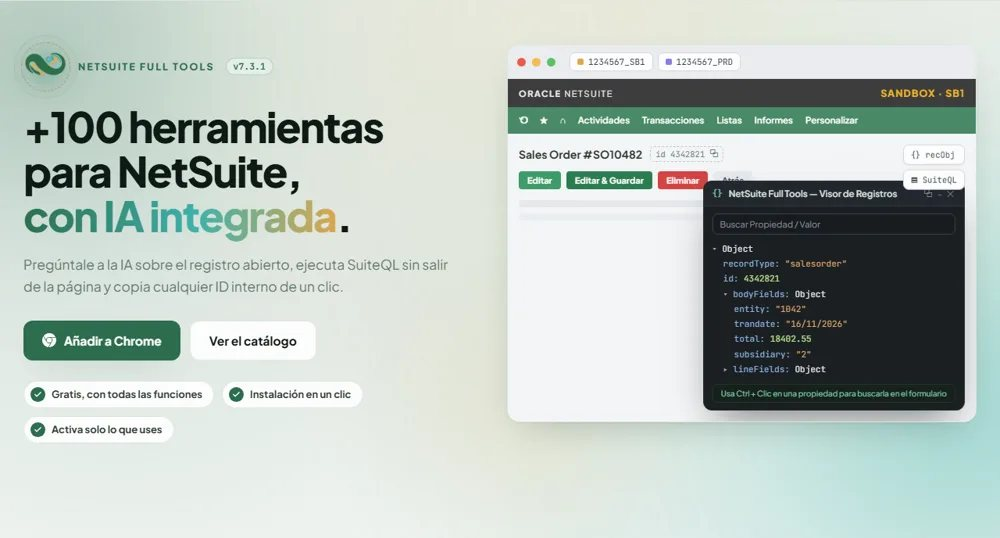
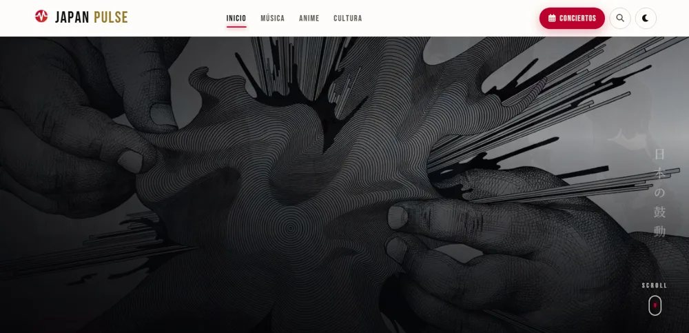
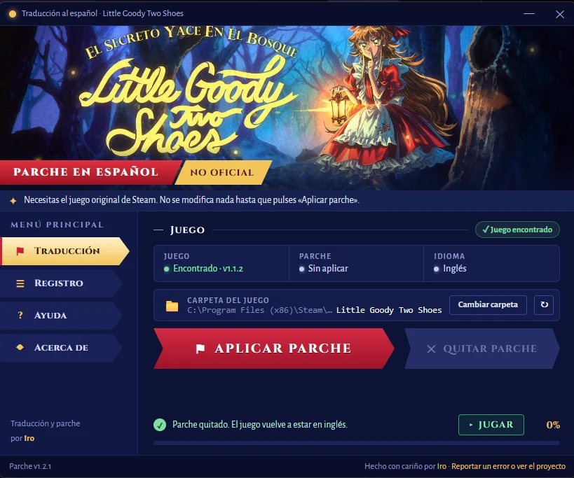

  

  
  
  
  
  
  
  
  
  
  
  

 

Desarrollador de software en México, especializado en **NetSuite** (SuiteScript y SuiteQL).
Como **Iro Dev** construyo extensiones, apps Android y sitios web que se usan a diario.

Fuera del código, traduzco **videojuegos** y **canciones del japonés al español** con efectos de karaoke,
y escribo sobre música japonesa en Japan Pulse.

EN · NetSuite developer from Mexico. I build Chrome extensions, Android apps and websites people use every day.

 

<table>
  <tr>
    <td width="50%"></td>
    <td width="50%">
      <b>EXTENSIÓN DE CHROME</b>
      <h3>NetSuite Full Tools</h3>
      Más de 100 herramientas para el día a día en NetSuite: editor de SuiteQL, asistente con IA, visor de registros, modo oscuro y atajos.
        
      <code>JavaScript</code> <code>Manifest V3</code> <code>ES · EN</code> <code>1 K usuarios</code> <code>5.0 estrellas</code>
        
      <a href="https://netsuitefulltools.com"><b>Sitio web</b></a> · <a href="https://chromewebstore.google.com/detail/netsuite-full-tools/fgldkomofdfcmkccjgalihlollndjmcc"><b>Chrome Web Store</b></a>
    </td>
  </tr>
  <tr>
    <td width="50%">
      <b>MEDIO DIGITAL</b>
      <h3>Japan Pulse</h3>
      Medio digital en español sobre música japonesa: noticias, lanzamientos y conciertos en Latinoamérica, además de anime y cultura.
        
      <code>Astro</code> <code>TypeScript</code> <code>Cloudflare</code> <code>Redacción</code>
        
      <a href="https://japan-pulse.com"><b>Visitar</b></a> · <a href="https://www.instagram.com/japanpulse.latam/"><b>Instagram</b></a>
    </td>
    <td width="50%"></td>
  </tr>
  <tr>
    <td width="50%"></td>
    <td width="50%">
      <b>TRADUCCIÓN DE VIDEOJUEGO</b>
      <h3>Little Goody Two Shoes, en español</h3>
      Traducción no oficial al español latinoamericano, con instalador propio para Windows y Steam Deck.
        
      <code>Localización</code> <code>Python</code> <code>Windows</code> <code>Steam Deck</code>
        
      <a href="https://github.com/IrodoriCiel/LGTS-Parche-Traduccion-Espanol/releases/latest"><b>Descargar parche</b></a> · <a href="https://github.com/IrodoriCiel/LGTS-Parche-Traduccion-Espanol"><b>Código</b></a>
    </td>
  </tr>
</table>

 

**Experiencia laboral**

- **NetSuite Developer** · CERBERUSTECK — ago 2022 – actualidad · remoto
  

  
Proyectos realizados

  - Conteos y ajustes de inventario
  - Generación de PDFs: cotizaciones, estados de cuenta, cheques, etiquetas y códigos de barras
  - Facturación electrónica CFDI 4.0: timbrado con PACs, cancelación, complementos de pago y Carta Porte
  - Producción: órdenes, ensamblajes, recetas, control de merma y liberación de calidad
  - Compras: requisiciones, solicitudes y flujos de aprobación
  - Pagos y tesorería: carga masiva de pagos, aplicación de pagos y depósitos
  - Control y cálculo de presupuestos
  - Contabilidad: reclasificación de cuentas, diarios y tipos de cambio
  - Traslados, lotes, logística y devoluciones
  - Importaciones masivas desde CSV
  - Dashboards, gráficas y reportes programados
  - Portales y módulos web dentro de NetSuite
  - Gestión de terrenos y lotes, mapas interactivos, contratos en PDF e integraciones con sistemas externos
  

- **Programador** · Facultad de Estudios Superiores Iztacala, UNAM — desde jul 2017

**Educación**

- **Diplomado en desarrollo de sistemas con tecnología Java** · UNAM · DGTIC — 2020
- **Lic. en Sistemas Computacionales** · Universidad Autónoma del Estado de Hidalgo — 2012–2016

**Certificaciones**

- **Desarrollo con IA: Programa con Agentes** · BIG school · MoureDev — nov 2026
- **AI for Data Analysis** · Google · Coursera — nov 2026 · [validar](https://www.coursera.org/account/accomplishments/verify/ZRZGLJ54CTG0)
- **AI for Content Creation** · Google · Coursera — nov 2026 · [validar](https://www.coursera.org/account/accomplishments/verify/UBVJLXX0E958)
- **AI Fundamentals** · Google · Coursera — nov 2026 · [validar](https://www.coursera.org/account/accomplishments/verify/9Q6C7TYJZZNI)
- **AI for Brainstorming and Planning** · Google · Coursera — nov 2026 · [validar](https://www.coursera.org/account/accomplishments/verify/NOCL1GR3DQOW)
- **AI for Research and Insights** · Google · Coursera — nov 2026 · [validar](https://www.coursera.org/account/accomplishments/verify/E271IU5TS27Z)
- **AI for Writing and Communicating** · Google · Coursera — nov 2026 · [validar](https://www.coursera.org/account/accomplishments/verify/J2HQZUJN6XMB)
- **Introducción al Desarrollo de Aplicaciones con Spring** (seminario TIC) · UNAM · DGTIC — feb 2022
- **Java Full Stack Developer** (Spring Boot + Angular) · MitoCode — nov 2021 · [validar](https://mitocode.com/certificados/#/check/b8ii0sucme4hqlv)

[Ver todas las constancias en mi portafolio →](https://irodoriciel.dev/#trayectoria)

 

  

   
   
  

 

¿Necesitas desarrollo en **NetSuite**? Personalizaciones, scripts, integraciones, reportes o un proyecto completo.
Si tienes otra idea que se resuelva con una herramienta, una extensión o una app, cuéntamelo.

  
  
  

  

